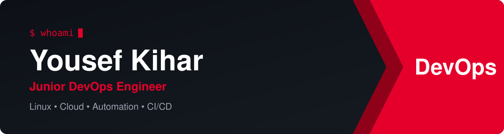
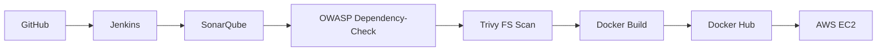

<div align="center">

[](assets/profile-header.svg)

[](https://github.com/YWKihar)
[](#featured-projects)
[](#whoami)
[](#connect)

### Linux • Cloud • Automation • CI/CD

**Learn. Build. Deploy.**

[Projects](#featured-projects) · [Toolbox](#toolbox) · [Learning](#currently-learning) · [Connect](#connect)

</div>

---

## whoami

Computer and Information Technology student and **DEPI (Digital Egypt Pioneers Initiative) DevOps trainee**, focused on Linux system administration, cloud infrastructure, automation, and application delivery.

I build hands-on labs and practical projects, document every implementation decision, and troubleshoot systematically. My goal is to grow into cloud operations, CI/CD, Infrastructure as Code, and observability through repeatable, well-documented work.

```text
$ whoami
yousef-kihar

$ cat focus.txt
linux · ansible · docker · aws · jenkins · devsecops

$ status
open to junior devops opportunities
```

---

## Toolbox

### Hands-on

[](https://skillicons.dev)

| Focus | What I've actually done |
|---|---|
| **Linux administration** | Fedora, Ubuntu, RHEL: packages, services, permissions, SSH |
| **Scripting & Git** | Bash scripts, Git workflows, GitHub |
| **Containers** | Dockerfiles, image builds, containers, port mapping |
| **Configuration management** | Ansible inventories, playbooks, and roles |
| **Cloud** | AWS EC2 setup and application deployment |
| **CI/CD** | Jenkins pipelines, SonarQube, OWASP Dependency-Check, Trivy |

### Currently learning

[](https://skillicons.dev)


---

## DevOps Pipeline

[](assets/devops-pipeline.svg)

---

## Featured Projects

### 01 · DevSecOps — Netflix Clone CI/CD Pipeline


A DevSecOps pipeline for a React-based Netflix clone: code quality analysis, dependency and image vulnerability scanning, containerization, and automated deployment to AWS EC2.



[](https://github.com/YWKihar/netflix-devsecops-pipeline)

<br>

### 02 · Cloud Deployment — AWS EC2 Portfolio with Ansible


Infrastructure configuration, Apache setup, and website deployment on an AWS EC2 instance, all managed as code with Ansible.

[](https://github.com/YWKihar/aws-ec2-ansible-portfolio)

<br>

### 03 · Automation — Ansible Apache Automation


Apache installation, service management, and package removal, evolving from basic playbooks into a modular structure using **Ansible Roles**.

[](https://github.com/YWKihar/ansible-apache-automation)

<br>

### 04 · Programming — Java Exercises


Console-based exercises covering programming fundamentals, input validation, and problem solving.

[](https://github.com/YWKihar/Java-Exercises)

---

## Current Engineering Focus

- ☁️ AWS and Azure cloud fundamentals
- 🧱 Terraform and Infrastructure as Code
- 🔁 Jenkins-based CI/CD and DevSecOps workflows
- 📊 Prometheus metrics and Grafana dashboards
- 🐳 Container-based application delivery
- 🐧 Linux troubleshooting and operational practices

---

## Connect

<div align="center">

[](https://www.linkedin.com/in/ywkihar/)
[](https://ywkihar.ywaelkihar.workers.dev/)

### Let's build and learn together.

Open to collaboration, knowledge sharing, and **junior DevOps opportunities**.

*Learn continuously. Build thoughtfully. Deliver reliably.*

</div>

<!--
Optional: re-enable once your activity grows.

[](https://github.com/YWKihar)
-->
